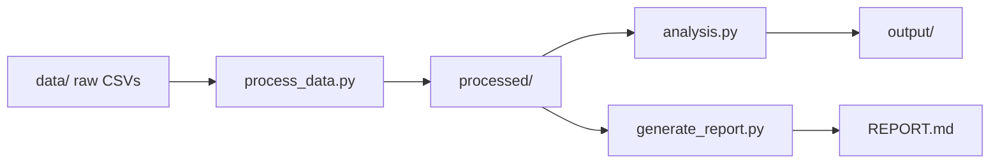

# IMPACT: Data Report

**Follow the Rupee: where did Mumbai's road repair money go?**

Generated from the files in `processed/` by `generate_report.py`. All data is synthetic (Claude Impact Lab dataset, CC BY 4.0). Flags are items to review, not proof of wrongdoing.

## 1. Pipeline

## 2. Processed files

| File | Rows | Columns | One row is |
|---|---|---|---|
| `work_orders_processed.csv` | 2,499 | 37 | A repair job, joined with rate card, road and ward details |
| `complaints_processed.csv` | 6,501 | 26 | A citizen complaint, cleaned |
| `complaint_workorder_links.csv` | 4,948 | 2 | One complaint linked to one work order |
| `ward_summary.csv` | 24 | 11 | A ward, with spend, budget and quality totals |

Period covered: 01 Jun 2025 to 05 Oct 2025.

## 3. Column structure

#### `work_orders_processed.csv`

| Column | Type | Meaning |
|---|---|---|
| `work_order_id` | text | Unique repair job ID |
| `linked_complaint_ids` | text | Complaint IDs separated by a pipe character |
| `ward_code` | text | BMC ward code |
| `road_id` | text | Road segment ID |
| `work_type` | text | Kind of problem fixed |
| `repair_method` | text | How it was fixed |
| `contractor_id` | text | Contractor ID |
| `contractor_name` | text | Contractor (fictional) |
| `assigned_at` | text | When the job was assigned |
| `work_started_at` | text | When work began |
| `completed_at` | text | When work finished |
| `area_sqm` | decimal | Area repaired (sq m) |
| `cost_inr` | integer | Amount billed (₹) |
| `sla_hours` | integer | Allowed hours (deadline) |
| `sla_met` | True/False | True if finished within the SLA |
| `reopened_within_30d` | True/False | True if the fix failed within 30 days |
| `engineer_remark` | text | Free-text engineer note |
| `unit` | text | Rate card unit (per sqm or per job) |
| `standard_rate_inr` | integer | Rate card price (₹) |
| `road_name` | text | Road name |
| `road_type` | text | Road class |
| `surface` | text | Road surface |
| `length_m` | integer | Road segment length (m) |
| `last_resurfaced` | text | Date last resurfaced |
| `under_dlp` | True/False | True if road is under a Defect Liability Period |
| `bus_route` | True/False | True if on a bus route |
| `ward_name` | text | Ward area names |
| `zone` | text | BMC zone |
| `low_lying_index` | decimal | Flood-proneness (higher = more) |
| `monsoon_repair_budget_inr_2025` | integer | Ward monsoon repair budget (₹) |
| `expected_cost_inr` | decimal | Rate-card cost for this job (₹) |
| `cost_ratio` | decimal | Billed ÷ expected (1.0 = exactly rate card) |
| `hours_to_start` | decimal | Assigned to work start (hours) |
| `hours_to_complete` | decimal | Assigned to completion (hours) |
| `month` | text | Month assigned (YYYY-MM) |
| `n_linked_complaints` | integer | Number of linked complaints |
| `has_complaint_link` | True/False | True if at least one complaint is linked |

#### `complaints_processed.csv`

| Column | Type | Meaning |
|---|---|---|
| `complaint_id` | text | Unique complaint ID |
| `received_at` | text | When the complaint arrived |
| `channel` | text | How it was reported |
| `category_reported` | text | Category chosen by the citizen |
| `description` | text | Complaint text (en, hi, mr, hi-en) |
| `language` | text | Language of the text |
| `locality_text` | text | Locality named in the complaint |
| `ward_code` | text | BMC ward code |
| `lat` | decimal | Latitude (often missing) |
| `lon` | decimal | Longitude (often missing) |
| `gps_accuracy_m` | decimal | GPS accuracy (m) |
| `photo_url` | text | Photo link (often missing) |
| `photo_description` | text | Text description of the photo |
| `complainant_id` | text | Anonymised citizen ID |
| `upvotes` | integer | Citizen upvotes |
| `status` | text | Complaint status |
| `resolved_at` | text | When resolved (blank if not) |
| `ward_code_filled` | text | Ward, filled from locality when missing |
| `ward_was_missing` | True/False | True if ward was blank in raw data |
| `has_gps` | True/False | True if coordinates present |
| `has_photo` | True/False | True if photo present |
| `hours_to_resolve` | decimal | Received to resolved (hours) |
| `is_duplicate` | True/False | True if closed as duplicate |
| `is_not_bmc` | True/False | True if rejected or forwarded to another body |
| `linked_to_work_order` | True/False | True if a work order links to it |
| `month` | text | Month assigned (YYYY-MM) |

#### `ward_summary.csv`

| Column | Type | Meaning |
|---|---|---|
| `ward_code` | text | BMC ward code |
| `jobs` | integer | Jobs in ward |
| `spend_inr` | integer | Total billed in ward (₹) |
| `reopened_jobs` | integer | Jobs that failed within 30 days |
| `sla_met_pct` | decimal | % jobs within SLA |
| `reopen_pct` | decimal | % jobs reopened |
| `ward_name` | text | Ward area names |
| `low_lying_index` | decimal | Flood-proneness (higher = more) |
| `monsoon_repair_budget_inr_2025` | integer | Ward monsoon repair budget (₹) |
| `budget_used_pct` | decimal | Spend ÷ budget × 100 |
| `complaints` | integer | Complaints in ward |

#### `complaint_workorder_links.csv`

| Column | Type | Meaning |
|---|---|---|
| `work_order_id` | text | Unique repair job ID |
| `complaint_id` | text | Unique complaint ID |

### Example row (work order)

- `work_order_id`: WO25-00001
- `ward_code`: K/E
- `road_name`: Western Express Highway
- `work_type`: Waterlogging
- `repair_method`: Dewatering pump deployed
- `contractor_name`: Sahyadri Infra Works (synthetic)
- `cost_inr`: 67026
- `expected_cost_inr`: 60000.0
- `cost_ratio`: 1.117
- `sla_met`: True
- `reopened_within_30d`: False
- `under_dlp`: False

## 4. Headline numbers

| Measure | Value |
|---|---|
| Total spend | ₹13.43 Cr |
| Work orders | 2,499 |
| Spend on fixes that failed within 30 days | ₹3.07 Cr (23%) |
| Jobs reopened within 30 days | 24.4% |
| Jobs meeting SLA | 49.6% |
| Jobs with at least one flag | 845 of 2,499 |
| Wards over budget | 6 of 24 |

## 5. Wards: budget vs spend

| Ward | Area | Spend | Budget | Budget used | Reopen % | Flagged jobs |
|---|---|---|---|---|---|---|
| E | Byculla, Agripada, Mumbai Central | ₹63.2 L | ₹53.0 L | 119.3% | 30.5 | 59 |
| R/C | Borivali | ₹33.1 L | ₹29.0 L | 114.2% | 14.0 | 36 |
| L | Kurla | ₹1.30 Cr | ₹1.19 Cr | 109.6% | 17.7 | 95 |
| M/W | Chembur | ₹46.9 L | ₹44.0 L | 106.6% | 27.6 | 31 |
| A | Colaba, Fort, Churchgate | ₹16.6 L | ₹16.0 L | 103.5% | 37.9 | 13 |
| R/S | Kandivali | ₹66.4 L | ₹66.0 L | 100.6% | 20.7 | 23 |
| H/W | Bandra West, Khar West, Santacruz West | ₹42.5 L | ₹43.0 L | 98.7% | 25.8 | 32 |
| N | Ghatkopar, Vikhroli | ₹60.0 L | ₹62.0 L | 96.8% | 19.6 | 25 |
| P/N | Malad | ₹70.1 L | ₹77.0 L | 91.0% | 24.8 | 53 |
| K/E | Andheri East, Vile Parle East, Jogeshwari East | ₹82.6 L | ₹91.0 L | 90.8% | 23.6 | 38 |
| P/S | Goregaon | ₹43.5 L | ₹48.0 L | 90.6% | 20.7 | 21 |
| F/N | Matunga, Sion, Wadala | ₹94.1 L | ₹1.05 Cr | 89.6% | 24.7 | 55 |
| C | Kalbadevi, Bhuleshwar, Marine Lines | ₹8.0 L | ₹9.0 L | 88.5% | 40.0 | 6 |
| G/S | Worli, Lower Parel, Prabhadevi | ₹28.2 L | ₹32.0 L | 88.2% | 32.8 | 23 |
| K/W | Andheri West, Juhu, Vile Parle West | ₹78.5 L | ₹89.0 L | 88.1% | 25.9 | 51 |
| F/S | Parel, Lalbaug, Sewri | ₹80.3 L | ₹98.0 L | 81.9% | 15.6 | 37 |
| B | Dongri, Masjid Bunder | ₹35.1 L | ₹43.0 L | 81.6% | 20.5 | 9 |
| G/N | Dadar West, Mahim, Dharavi | ₹67.6 L | ₹84.0 L | 80.4% | 29.5 | 50 |
| D | Grant Road, Malabar Hill, Tardeo | ₹12.7 L | ₹16.0 L | 79.5% | 20.0 | 14 |
| M/E | Govandi, Mankhurd, Deonar | ₹72.4 L | ₹91.0 L | 79.5% | 26.4 | 54 |
| S | Bhandup, Powai, Kanjurmarg | ₹74.9 L | ₹95.0 L | 78.8% | 32.5 | 34 |
| T | Mulund | ₹39.5 L | ₹51.0 L | 77.5% | 32.3 | 21 |
| H/E | Bandra East, Santacruz East, Khar East | ₹61.5 L | ₹82.0 L | 74.9% | 26.1 | 38 |
| R/N | Dahisar | ₹35.3 L | ₹48.0 L | 73.6% | 26.8 | 27 |

## 6. Contractor scorecard

| Contractor | Jobs | Spend | SLA met | Reopen | Median cost vs rate card | Jobs over 1.5x |
|---|---|---|---|---|---|---|
| Western Coast Asphalt Co | 299 | ₹1.75 Cr | 47.2% | 38.8% | 1.06x | 5 |
| Mahalaxmi Civil Contractors | 303 | ₹1.62 Cr | 39.3% | 37.6% | 1.08x | 42 |
| Arabian Sea Engineering | 328 | ₹1.86 Cr | 43.6% | 32.3% | 1.08x | 37 |
| Konkan Roadcon Pvt Ltd | 337 | ₹1.89 Cr | 46.0% | 26.7% | 1.05x | 5 |
| Shivneri Construction | 289 | ₹1.47 Cr | 47.1% | 26.3% | 1.05x | 3 |
| Sahyadri Infra Works | 337 | ₹1.72 Cr | 62.3% | 13.6% | 1.06x | 3 |
| Mithi Infra Projects | 319 | ₹1.71 Cr | 51.7% | 11.6% | 1.04x | 10 |
| Deccan Paving Solutions | 287 | ₹1.41 Cr | 59.6% | 9.1% | 1.01x | 4 |

Reopen % is the share of a contractor's jobs that failed within 30 days. Read it next to ward flood risk (section 9) before judging a contractor.

## 7. Repair method and work type

| Repair Method | Jobs | Spend | Reopen % |
|---|---|---|---|
| Cold mix patch | 602 | ₹75.4 L | 32.2 |
| Drain desilting | 221 | ₹2.12 Cr | 26.2 |
| Mastic asphalt | 298 | ₹87.0 L | 25.8 |
| Paver blocks relaid | 132 | ₹86.5 L | 22.7 |
| Hot mix patch | 318 | ₹53.5 L | 22.6 |
| Desilting and garbage removal | 232 | ₹1.80 Cr | 22.4 |
| Pump + debris removal | 198 | ₹2.34 Cr | 22.2 |
| Excavation, pipeline repair, PQC patch | 96 | ₹1.87 Cr | 21.9 |
| Manhole cover replaced + grating | 202 | ₹99.1 L | 17.3 |
| Dewatering pump deployed | 200 | ₹1.29 Cr | 14.0 |

| Work Type | Jobs | Spend | Reopen % |
|---|---|---|---|
| Pothole | 1218 | ₹2.16 Cr | 28.2 |
| Broken paver blocks | 132 | ₹86.5 L | 22.7 |
| Choked drain / nullah overflow | 232 | ₹1.80 Cr | 22.4 |
| Road cave-in | 96 | ₹1.87 Cr | 21.9 |
| Waterlogging | 619 | ₹5.75 Cr | 21.0 |
| Open or broken manhole | 202 | ₹99.1 L | 17.3 |

## 8. Monthly activity

| Month | Jobs | Spend |
|---|---|---|
| 2025-06 | 453 | ₹2.70 Cr |
| 2025-07 | 899 | ₹4.55 Cr |
| 2025-08 | 747 | ₹4.06 Cr |
| 2025-09 | 380 | ₹2.04 Cr |
| 2025-10 | 20 | ₹8.0 L |

## 9. Fairness check: flood risk vs failures

Wards split into three equal groups by `low_lying_index`:

| Flood risk | Jobs reopened within 30 days |
|---|---|
| Low | 25.0% |
| Mid | 26.3% |
| High | 21.3% |

Failure rates are similar across risk groups, so flood risk alone does not explain why repairs fail.

## 10. Audit flags

| Flag | Rule | Jobs |
|---|---|---|
| Overbilled | Cost is more than 1.5x the rate card | 109 |
| DLP paid | Road is under its Defect Liability Period, so repair should be free | 493 |
| Double billed | Same road and repair method billed again within 7 days | 331 |
| No complaint | Work order has no linked citizen complaint | 45 |

A job can carry more than one flag. The DLP and double-billing rules are broad and should be sampled by hand before any conclusion is drawn.

## 11. Complaints

- Total complaints: 6,501; closed as duplicates: 1,014 (15.6%)
- Median time to resolve (resolved complaints): 61.7 hours
- Missing ward in raw data: 457; still missing after filling from locality: 31
- With GPS: 58%; with photo: 44%

**Status**

| Value | Complaints | Share |
|---|---|---|
| Resolved | 3934 | 60.5% |
| Closed - Duplicate | 1014 | 15.6% |
| Open | 617 | 9.5% |
| Rejected - Not BMC road | 301 | 4.6% |
| Forwarded to MMRDA/PWD | 279 | 4.3% |
| In Progress | 279 | 4.3% |
| Forwarded to SWM dept | 47 | 0.7% |
| Rejected - Not road issue | 30 | 0.5% |

**Channel**

| Value | Complaints | Share |
|---|---|---|
| MyBMC App | 3571 | 54.9% |
| 1916 Helpline | 2106 | 32.4% |
| MyBMC Web Portal | 566 | 8.7% |
| Ward Office Walk-in | 258 | 4.0% |

**Category**

| Value | Complaints | Share |
|---|---|---|
| Pothole | 2647 | 40.7% |
| Waterlogging | 1320 | 20.3% |
| Open or broken manhole | 685 | 10.5% |
| Choked drain / nullah overflow | 581 | 8.9% |
| Road cave-in | 442 | 6.8% |
| Broken paver blocks | 427 | 6.6% |
| Road related | 201 | 3.1% |
| Other | 198 | 3.0% |

**Language**

| Value | Complaints | Share |
|---|---|---|
| en | 3626 | 55.8% |
| hi-en | 1538 | 23.7% |
| mr | 805 | 12.4% |
| hi | 532 | 8.2% |

## 12. Limitations

- The data is synthetic, so findings describe this dataset only.
- Flag thresholds (1.5x rate card, 7 days) are starting points and need review.
- Duplicate and out-of-scope complaints are marked, not removed.
- October 2025 has very few records, so monthly trends for that month are not reliable.
